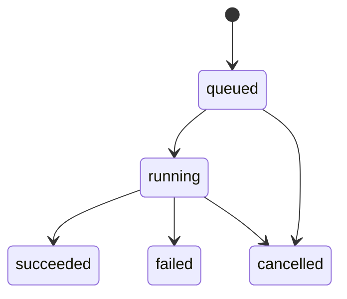

A run is one execution of one workflow version.

## Lifecycle states

| State | Meaning | Terminal |
| --- | --- | --- |
| `queued` | Accepted and waiting to execute. | No |
| `running` | Execution is in progress. | No |
| `succeeded` | All steps completed successfully. | Yes |
| `failed` | A step or the execution failed. | Yes |
| `cancelled` | Cancellation completed. | Yes |

## Key fields

| Field | Meaning |
| --- | --- |
| `workflow_version` | The workflow version the run started with. It never changes. |
| `execution_mode` | `sync` or `async`. |
| `attempt` | 1 for a first run. Each manual retry adds one. |
| `original_run_id` | The first run in a retry chain, or `null`. |
| `started_at`, `completed_at` | `null` until the run starts or reaches a terminal state. |
| `cancel_requested_at` | Set when cancellation was requested, even if the run is still `running`. |
| `failure` | For failed runs: `code` (`STEP_FAILED`, `EXECUTION_TIMEOUT` or `INTERNAL_ERROR`), `message` and the failing `step_id`. Otherwise `null`. |

## Reading results

Results are available only for `succeeded` runs. For other states `GET /v1/runs/{run_id}/results` returns `409`: `RUN_NOT_COMPLETED` while the run is `queued` or `running`, and `INVALID_STATE` when it `failed` or was `cancelled`.

## Related

- [Retries and cancellation](/docs/concepts/retries-and-cancellation)
- [Inspect a run](/docs/guides/inspect-a-run)
- [Limits and retention](/docs/reference/limits-and-retention)
